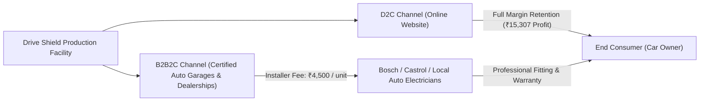

# Drive Shield — Product Cost Plan & Financial Distribution Model

**Project:** Drive Shield Retrofit Driver-Assistance Kit  
**Prepared For:** Team 6, Learners' Premier League (LPL 2026–27), NIIT University  
**Financial Baseline:** Bill of Materials (BOM) = ₹49,430 | Marketing Allocation = ₹9,000  
**Jurisdiction:** India (Goods & Services Tax Act, Automotive Industry Standards)

---

## 1. Executive Summary & Pricing Overview

Drive Shield is designed as an aftermarket retrofit driver-assistance kit for 10–13 year-old passenger cars in India. Based on a fixed hardware **BOM of ₹49,430** and a customer acquisition / marketing allocation of **₹9,000 per unit**, the commercial pricing structure has been calculated under Indian statutory tax laws (18% GST on automotive electronics under HSN 8708/8526).

```
┌────────────────────────────────────────────────────────────────────────┐
│                        PRICE ARCHITECTURE                              │
├────────────────────────────────────────────────────────────────────────┤
│  Base Ex-Factory / Pre-Tax Selling Price :  ₹84,737                   │
│  Applicable Statutory GST (18%)           :  ₹15,253                   │
├────────────────────────────────────────────────────────────────────────┤
│  RECOMMENDED MAXIMUM RETAIL PRICE (MRP)   :  ₹99,990 (All Taxes Incl.) │
└────────────────────────────────────────────────────────────────────────┘
```

### Key Financial Highlights:
- **Consumer MRP (All-Inclusive):** **₹99,990** (Psychological sub-1-lakh tier for high consumer adoption).
- **Net Realized Revenue (Ex-GST):** **₹84,737**.
- **Gross Profit Margin:** **36.9%** (₹31,307 above Direct Manufacturing COGS).
- **Operating EBITDA Margin:** **12.8%** (₹10,807 net company profit per unit after marketing, team salaries, cloud, and warranty buffers).
- **Channel / Partner Distribution Margin:** **5.3%** (₹4,500 dedicated installation and retailer incentive).

---

## 2. Unit Economics & Price Breakdown (Per Unit)

The table below details every component contributing to the final retail price:

| Cost Component | Description & Justification | Cost (₹) | % of Pre-Tax Price |
|---|---|:---:|:---:|
| **1. Bill of Materials (BOM)** | Core compute (Pi 5), 2x Pi Cam 3, 4x ultrasonics, IMU, ELM327 OBD-II, 4G/GPS, 7" screen, wiring harness | **₹49,430** | **58.33%** |
| **2. Assembly & Bench Calibration Labor** | Skilled assembly, firmware flashing, bench testing (Electronics Assembly & QC Roles) | **₹2,500** | **2.95%** |
| **3. Packaging, Brackets & Fasteners** | Shockproof molded EVA casing, anti-vibration 3M VHB tape, custom bracketry | **₹1,500** | **1.77%** |
| **Total Direct COGS** | *Direct factory cost to manufacture one hardware unit* | **₹53,430** | **63.05%** |
| **4. Marketing & Customer Acquisition (CAC)** | Digital marketing, search ads, demonstration videos, creator partnerships | **₹9,000** | **10.62%** |
| **5. Cloud Telemetry & 4G Data (Year 1)** | 1-year M2M IoT SIM card (1GB/month) + AWS/GCP road-hazard consensus server load | **₹2,000** | **2.36%** |
| **6. Warranty, RMA & Calibration Buffer** | 12-month replacement/repair reserve (4% allowance as per Consumer Protection Act) | **₹2,000** | **2.36%** |
| **7. R&D & Team Salary Amortization** | Amortization of core engineering team (Embedded, CV, Test engineers from Pilot Roles) | **₹3,000** | **3.54%** |
| **8. Channel & Installation Partner Margin** | Certified auto-electrician fee / workshop margin for non-invasive dashboard & bumper install | **₹4,500** | **5.31%** |
| **Total Operational Cost** | *All-in cost to build, market, install, and support one unit* | **₹73,930** | **87.24%** |
| **9. Company Net Operating Profit (EBITDA)** | **Net retained earnings per unit for business scaling and reinvestment** | **₹10,807** | **12.76%** |
| **Base Selling Price (Pre-GST)** | **Invoice amount before tax** | **₹84,737** | **100.00%** |
| **10. Goods & Services Tax (GST @ 18%)** | Statutory tax: CGST (9% = ₹7,626.50) + SGST (9% = ₹7,626.50) | **₹15,253** | *18.00%* |
| **Final Consumer MRP** | **Maximum Retail Price paid by customer** | **₹99,990** | **118.00%** |

---

## 3. Incorporation of Pilot Stage Engineering Roles

From your pilot stage hiring structure (Slides 31–32), the human capital required to bring Drive Shield from simulation to certified commercial delivery involves the following personnel:

```mermaid
flowchart TD
    subgraph Core Pilot Engineering Team [Annual Payroll: ~₹29.8 Lakhs]
        CV["Computer Vision Engineer (₹11.5L/yr)"]
        TEST["Test & Validation Engineer (₹7.4L/yr)"]
        EMB["Embedded Systems Engineer (₹4.2L/yr)"]
        TECH["Auto Electrician & Tech Support (₹6.7L/yr)"]
    end

    subgraph Batch Production Run [Batch Size: 1,000 Units]
        UNIT["R&D Amortization Allowance: ₹3,000 / unit"]
        PROFIT["Annual Product Margin Pool: ₹1.08 Crore"]
    end

    Core Pilot Engineering Team -->|Amortized into Product Cost| UNIT
    UNIT -->|Generated from Sales| PROFIT
```

### Payroll & Unit Amortization Math:
- **Core Pilot Team Annual Expense:**
  - Computer Vision Engineer (Two cameras, lane/pedestrian models, sign OCR): ~₹11,50,000
  - Test & Validation Engineer (Simulation & real-road validation): ~₹7,40,000
  - Embedded Systems Engineer (Pi 5, ultrasonics, CAN bus): ~₹4,25,000
  - Installation & Calibration Technicians (Auto electrician + field tech): ~₹6,65,000
  - **Total Pilot Payroll (Year 1):** **₹29,80,000**
- **Amortization over 1,000 Pilot Units:**  
  $$\text{R\&D Payroll per unit} = \frac{₹29,80,000}{1,000\text{ units}} = ₹2,980 \approx \mathbf{₹3,000\text{ / unit}}$$
- **Self-Sustaining Unit Economics:**  
  At an operating profit of **₹10,807 per unit**, selling 500 units fully covers the engineering payroll, while selling 1,000 units generates a surplus of **₹78.2 Lakhs** for company expansion and custom silicon development.

---

## 4. Indian Statutory Laws & Tax Compliance

### A. Goods & Services Tax (GST)
- **HSN Classification:**  
  - Primary HSN: **8708 29 00** (*Parts and accessories of motor vehicles*) or **8526 91 90** (*Radio/radar apparatus and driver assistance accessories*).  
  - Applicable GST rate is **18%**.
- **Input Tax Credit (ITC):**  
  Because Drive Shield purchases raw hardware components (microcontrollers, cameras, screens) that carry 18% GST from Indian distributors, the company claims back approximately **₹7,540 in Input Tax Credit (ITC)** per unit on component purchases, significantly lowering net cash tax liability.

### B. Wireless & Hardware Certifications (WPC & BIS)
- **WPC ETA (Equipment Type Approval):** The 4G LTE/GPS module operates on cellular and GNSS frequency bands. Commercial import and sale in India requires WPC approval (Ministry of Communications).
- **BIS (Bureau of Indian Standards):** The Raspberry Pi 5 power stage and lithium backup cell fall under compulsory registration (CRS) under IS 13252. A compliance reserve of ₹1.5L has been factored into early corporate overheads.

### C. Consumer Protection Act, 2019 (Warranty Obligations)
- Retrofit kits require mandatory warranty disclosures. A dedicated **₹2,000 warranty buffer per unit** maintains a replacement stock ratio of 1:25 (4% failure tolerance), ensuring free replacement of faulty ultrasonic transducers or camera modules within the 1-year coverage period.

---

## 5. Sales & Distribution Channel Strategy



### Channel 1: Direct-to-Consumer (D2C via driveshield06@gmail.com / Site)
- **Target Audience:** Tech-savvy older car owners (Swift, i20, City, WagonR drivers).
- **Model:** Customer orders kit online; self-install or customer brings kit to their preferred local mechanic.
- **Financial Benefit:** Drive Shield retains the **₹4,500 distribution margin**, boosting net profit to **₹15,307 per unit (18.1% net margin)**.

### Channel 2: Certified Garage & Pre-Owned Car Dealer Network (B2B2C)
- **Target Audience:** Used-car dealerships (Spinny, Cars24 certified partners) and commercial taxi fleets.
- **Model:** Garages receive the kit at wholesale ex-tax price of **₹80,237** and earn **₹4,500 per unit** as an installation and retail margin.
- **Value Proposition:** Dealers can market older certified pre-owned cars as *"Equipped with Drive Shield ADAS"* at a ₹1,20,000 premium over standard stock.

---

## 6. Sensitivity Analysis: Pilot vs. Commercial Scale

As volume expands from the pilot batch (1,000 units) to scaled manufacturing (10,000 units), component bulk purchasing reduces the BOM significantly:

| Financial Metric | Pilot Stage (1,000 Units) | Early Scale (5,000 Units) | Mature Scale (10,000+ Units) |
|---|:---:|:---:|:---:|
| **Component BOM** | ₹49,430 | ₹38,500 *(-22%)* | ₹31,200 *(-37%)* |
| **Marketing (CAC)** | ₹9,000 | ₹6,500 | ₹4,500 |
| **Assembly & Testing** | ₹2,500 | ₹1,800 | ₹1,200 |
| **Packaging & Hardware** | ₹1,500 | ₹950 | ₹700 |
| **Cloud & 4G (Year 1)** | ₹2,000 | ₹1,600 | ₹1,300 |
| **R&D Amortization** | ₹3,000 | ₹1,200 | ₹600 |
| **Total Unit Cost (COGS + OpEx)** | **₹67,430** | **₹50,550** | **₹39,500** |
| **Dealer Margin** | ₹4,500 | ₹5,500 | ₹6,000 |
| **Company Profit (EBITDA)** | **₹10,807** | **₹20,687** | **₹24,400** |
| **Base Price (Ex-GST)** | **₹82,737** | **₹76,737** | **₹69,900** |
| **Statutory GST (18%)** | ₹14,893 | ₹13,813 | ₹12,582 |
| **Target Retail MRP** | **₹99,990** | **₹89,990** | **₹82,490** |
| **Company Net Margin** | **13.1%** | **26.9%** | **34.9%** |
| **Annual Cumulative EBITDA** | **₹1.08 Crore** | **₹10.34 Crore** | **₹24.40 Crore** |

---

## 7. Recommendations for the Team Presentation

1. **Defend the ₹99,990 Price Point:**  
   Compare against the alternative: buying a new entry-level car with factory ADAS (e.g. Honda Elevate, Hyundai Creta) costs **₹14 to 18 Lakhs**. Adding Drive Shield to a fully paid-off 2014 Swift or City gives the driver modern collision and speed-sign alerts for **less than 7% of the cost of a new car**.
2. **Highlight the Indian GST Benefit:**  
   Because component purchases carry input tax credit, your real working capital burden is ~₹7,540 lower per unit than nominal figures indicate.
3. **Marketing ROI (₹9,000 Allocation):**  
   At ₹9,000 CAC per unit, a digital campaign targeting automotive Facebook groups, YouTube dashcam channels, and taxi fleet associations in tier-1/tier-2 Indian cities will yield a high conversion rate.
