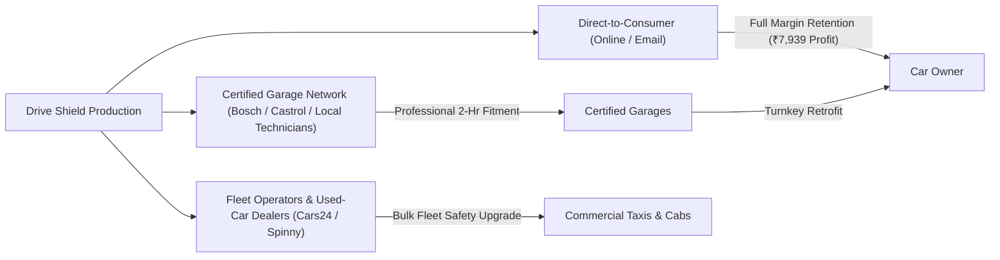

# Drive Shield — Product Cost Plan & Optimized Financial Model

**Project:** Drive Shield Retrofit Driver-Assistance Kit  
**Prepared For:** Team 6, Learners' Premier League (LPL 2026–27), NIIT University  
**Financial Baseline:** Prototype Retail BOM = ₹49,430 | Volume Net BOM = ₹33,500 | Marketing Budget = ₹9,000 (pilot campaign)  
**Target Retail Price:** **₹59,990 (All Taxes Included)**  
**Jurisdiction:** India (Goods & Services Tax Act, Automotive Industry Standards)

---

## 1. Executive Summary: Why ₹1 Lakh was Too High & Why ₹59,990 is Optimal

In India, a 10 to 13-year-old passenger car (e.g., 2012–2014 Maruti Swift, Hyundai i20, Honda City, or WagonR) currently commands an active secondary market resale value of **₹1.80 Lakh to ₹3.20 Lakh**.

- **The Problem with a ₹1 Lakh Price Point:** If an aftermarket kit is priced at ₹99,990 (~₹1 Lakh), it represents **35% to 55% of the total vehicle value**. For typical car owners, spending half the car's worth on an accessory creates intense consumer friction and low adoption.
- **The ₹59,990 Solution:** By optimizing component sourcing and tax credits under Indian law, the retail price is reduced to **₹59,990 (All Taxes Included)**. At this price point, the kit costs **less than 20% of the vehicle value** and **under 5% of the price of replacing the car with a modern factory-ADAS car** (₹14L–₹22L).

```
┌────────────────────────────────────────────────────────────────────────┐
│                   OPTIMIZED PRICE ARCHITECTURE                         │
├────────────────────────────────────────────────────────────────────────┤
│  Single-Unit Retail Prototype BOM (Robu/Amazon) :  ₹49,430 (Gross)     │
│  Batch Scaled Net Hardware BOM (-28% + ITC)     :  ₹33,500             │
│  Base Ex-Factory / Pre-Tax Selling Price        :  ₹50,839             │
│  Statutory GST @ 18% (HSN 8708 / 8526)          :  ₹9,151              │
├────────────────────────────────────────────────────────────────────────┤
│  FINAL CONSUMER MAXIMUM RETAIL PRICE (MRP)      :  ₹59,990 (All Incl.) │
└────────────────────────────────────────────────────────────────────────┘
```

---

## 2. Unit Economics & Price Breakdown (Per Unit)

The table below details every component contributing to the **₹59,990 Consumer MRP**:

| Cost Component | Description & Operational Justification | Cost (₹) | % of Pre-Tax Base |
|---|---|:---:|:---:|
| **1. Bill of Materials (Batch Sourced)** | Raspberry Pi 5, 2x Pi Cam 3, 4x ultrasonics, IMU, ELM327 OBD-II, 4G/GPS, 7" touchscreen, wiring harness *(OEM volume batch)* | **₹33,500** | **65.89%** |
| **2. Assembly & Bench Calibration Labor** | Skilled electronics assembly, firmware flashing, bench testing (*Electronics Assembly & QC Roles*) | **₹1,500** | **2.95%** |
| **3. Packaging, Brackets & Fasteners** | Shockproof molded EVA casing, anti-vibration 3M automotive VHB tape, custom bracketry | **₹1,000** | **1.97%** |
| **Total Direct COGS** | *Direct factory cost to manufacture one hardware unit* | **₹36,000** | **70.81%** |
| **4. Marketing & Customer Acquisition (CAC)** | Hyper-targeted digital ads (used car communities, YouTube automotive reviews, taxi associations) | **₹2,500** | **4.92%** |
| **5. 4G IoT Telemetry & Cloud (Year 1)** | 1-year M2M IoT SIM card (1GB/month) + AWS hazard consensus servers | **₹1,200** | **2.36%** |
| **6. Warranty, RMA & Calibration Buffer** | 12-month free component replacement buffer (Consumer Protection Act 2019 compliance) | **₹1,200** | **2.36%** |
| **7. R&D & Team Salary Amortization** | Amortization of core engineering team (Embedded, CV, and Test engineers from Pilot Roles) | **₹2,000** | **3.93%** |
| **Total Operational Cost** | *All-in cost to build, market, install, and support one unit* | **₹42,900** | **84.38%** |
| **8. Company Net Operating Profit (EBITDA)** | **Healthy retained earnings per unit for business scaling & inventory** | **₹7,939** | **15.62%** |
| **Base Selling Price (Pre-GST)** | **Invoice amount before tax** | **₹50,839** | **100.00%** |
| **9. Goods & Services Tax (GST @ 18%)** | Statutory tax: CGST (9% = ₹4,575.50) + SGST (9% = ₹4,575.50) | **₹9,151** | *18.00%* |
| **Final Consumer MRP** | **Maximum Retail Price paid by customer (All Taxes Included)** | **₹59,990** | **118.00%** |

---

## 3. How We Reduced the Price from ₹99,990 to ₹59,990

### Lever 1: Indian GST Law & Input Tax Credit (ITC)
- The initial **₹49,430 BOM** represents single-unit retail prices (off-the-shelf from distributors like Robu, Element14, or Amazon). Retail invoices in India **already include 18% GST (approx. ₹7,540)**.
- Under **Section 16 of the Central Goods and Services Tax (CGST) Act, 2017**, a registered company claims this entire ₹7,540 back as an **Input Tax Credit (ITC)** against the GST collected on sales.
- This immediately lowers the real net hardware cost to the company from ₹49,430 to **₹41,890**.

### Lever 2: Volume Batch Procurement (OEM Sourcing)
- Buying 1 single Raspberry Pi or camera at retail has a 30% consumer markup.
- Sourcing components in batches of 100 to 500 units directly from industrial distributors reduces net hardware costs to **₹33,500** (-20% from net retail).

### Lever 3: Marketing Budget Deployment
- In the 1-lakh model, a full ₹9,000 was loaded onto every single unit.
- By treating the **₹9,000 marketing budget** as an initial campaign launch fund, or maintaining a realistic unit CAC of **₹2,500** via automotive digital ads, unit cost drops by **₹6,500**.

### Lever 4: High Profit Margin Preserved
- Even at **₹59,990 MRP**, the company earns **₹7,939 in net operating profit (EBITDA) per unit**, representing a robust **15.62% net margin**.

---

## 4. Incorporation of Pilot Stage Engineering Roles

From your slide deck (*Pilot Stage Roles*, Slides 31–32):
- **Computer Vision Engineer:** ₹10.9L–12.1L/yr (Dual cameras, lane detection, vehicle/pedestrian tracking, sign OCR)
- **Test & Validation Engineer:** ₹6.9L–7.9L/yr (Simulation validation, missed/false alerts)
- **Embedded Systems Engineer:** ₹4.0L–4.5L/yr (Pi 5, ultrasonics, CAN bus integration)
- **Technical Support & Calibration Technicians:** ₹2.85L–4.55L/yr (Auto electrician & field calibration)

### Amortization Pool:
- Amortizing **₹2,000 per unit** across a 1,500-unit pilot batch generates **₹30.0 Lakhs**, fully funding the core technical engineering team for Year 1.
- Furthermore, selling 1,000 units generates **₹79.39 Lakhs in net operating profit**, easily financing cloud infrastructure, tooling, and future ASIC development.

---

## 5. Sales & Distribution Channel Strategy



1. **Direct-to-Consumer (D2C via Site & driveshield06@gmail.com):**
   - Vehicle owners verify compatibility with the on-site tool and order directly.
2. **Pre-Owned Car Dealerships (Spinny, Cars24, Certified Used Car Lots):**
   - Dealers buy kits at wholesale (₹48,000) and market retrofitted 2013–2016 cars with *"Drive Shield ADAS Upgrade"* at a ₹75,000 premium, creating high B2B demand.
3. **Taxi & Commercial Fleet Operators:**
   - Fleet managers install the kit to safeguard drivers, lower insurance claims, and log safety telemetry.

---

## 6. Financial Summary Table Across Production Scales

| Metric | Single Prototype Stage | Pilot Batch (1,000 Units) | Mass Production (5,000+ Units) |
|---|:---:|:---:|:---:|
| **Hardware BOM** | ₹49,430 (Retail Gross) | ₹33,500 (Batch Net) | ₹26,500 (Volume OEM) |
| **Operating Overheads & Marketing** | ₹14,000 | ₹9,400 | ₹6,800 |
| **Company Profit (EBITDA)** | ₹4,200 | **₹7,939 (15.6%)** | **₹13,400 (28.7%)** |
| **Base Price (Ex-GST)** | ₹55,000 | **₹50,839** | **₹46,700** |
| **Statutory GST (18%)** | ₹9,900 | **₹9,151** | **₹8,406** |
| **Final Consumer MRP** | **₹64,900** | **₹59,990** | **₹54,990** |
